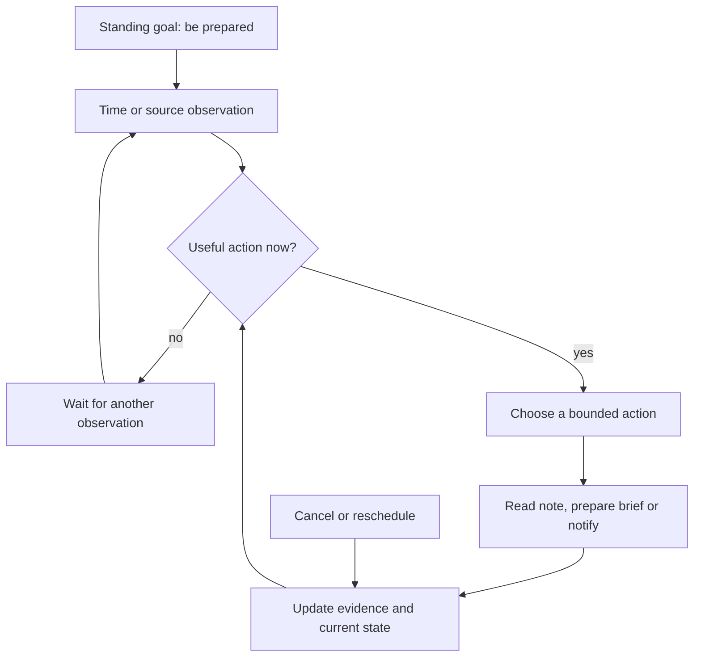
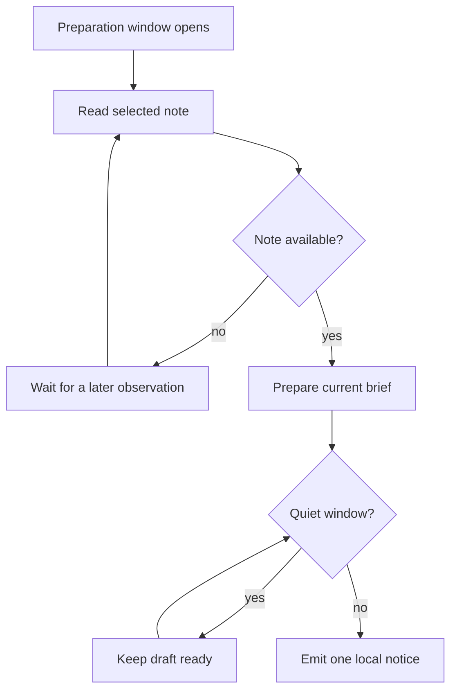
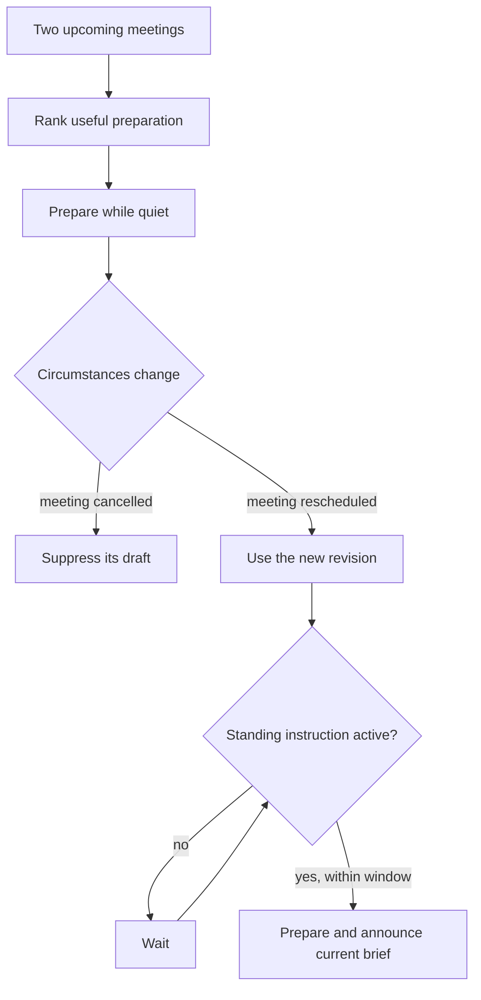

# Proactive agents: anticipate, investigate, reconsider

A proactive agent pursues a standing goal without needing a new prompt for every
step. It notices when an opportunity to help is approaching, obtains information
when that would change the next action, and revises its behavior as circumstances
change. Sometimes its best action is to wait or remain quiet.

This tutorial builds that behavior with three tiny local tools. It runs with
Noema, Google ADK and LangGraph. All use the same synthetic meetings, policy and
observations. No model credentials, calendar account or cloud service is needed.

**Start with the concept and three lessons below.** The comparison is an appendix,
not a claim that proactivity belongs to one framework.

## Run it

From a checkout of this repository, using Python 3.12 for the tested comparison:

```bash
python -m venv .venv
source .venv/bin/activate
python -m pip install -e .
python -m examples.proactive.lessons --level 1
python -m examples.proactive.lessons --level 2
python -m examples.proactive.lessons --level 3
```

The Noema-only scripts use the standard library and the SDK. The optional
comparison and notebooks require additional packages:

```bash
python -m pip install -r examples/proactive/requirements.txt
python -m examples.proactive.lessons --framework adk --level 3
python -m examples.proactive.lessons --framework langgraph --level 3
python -m examples.proactive.comparison --output /tmp/proactive-observations
python -m unittest tests.test_proactive_examples -v
python -m examples.proactive.notebooks --execute
```

`requirements.txt` pins the direct tutorial dependencies. The
[tested environment](observed/environment-freeze.txt) records transitive versions
from the reference run; it is a Linux/Python 3.12 environment snapshot, not a
universal platform lock. To recreate that environment in a clean Python 3.12 venv,
install it with `pip install -r examples/proactive/observed/environment-freeze.txt`
and install this repository with `pip install -e .`. Noema was tested against
source baseline `621be5a8a0823c1a02c893edc69967f552e0895d`; the tutorial commit adds
examples and documentation without changing SDK runtime code.

The [independent reproduction run](https://github.com/crbazevedo/noema-agent-sdk/actions/runs/34264959328)
passed all framework checks and executed the three notebooks in fresh Jupyter
kernels: 22 code cells in total. The committed notebooks include those executed
outputs. [Verification metadata](observed/verification.json) identifies the tested
source commit and CI runs; [notebook receipts](observed/notebooks.json) record the
executed files' hashes. Re-execution may change timestamps and generated event IDs.

## Why proactivity, and why now?

An answer can be correct and arrive too late. Consider a meeting starting at
10:00: useful assistance may involve preparing at 09:55, finding a missing fact,
and discarding an old brief when the meeting moves. The goal persists while the
appropriate action changes.

Timing and interruption are established design concerns. Horvitz’s work on
mixed-initiative interfaces treats the benefit of assistance together with the
cost of interruption and uncertainty about the user’s goals. Our quiet window is
a deliberately simple policy illustrating that concern. [Horvitz, 1999](https://erichorvitz.com/chi99horvitz.pdf).

What makes this practical to build now is the availability of composable execution,
tool and persistence infrastructure. Current ADK exposes deterministic workflows
and ambient event triggers; LangGraph exposes persisted graph state. These provide
usable machinery for implementing proactive behavior, but do not choose the
right goal or interruption policy for a product. [ADK workflows](https://adk.dev/graphs/),
[ambient agents](https://adk.dev/runtime/ambient-agents/),
[LangGraph persistence](https://docs.langchain.com/oss/python/langgraph/persistence).

Language models can help interpret open-ended goals, retrieve relevant memories
and propose plans. Research on generative agents illustrates the combination of
observation, memory, reflection and planning in a simulated environment; it does
not establish production personal-assistant reliability. [Park et al., 2023](https://arxiv.org/abs/2304.03442).

We use deterministic rules here to isolate the concept. A proactive agent does
not require a model call on every clock tick. An LLM can later replace a specific
interpretation or planning step while the same observable behavior is tested.

## The recurring loop



The **outer loop** observes changes while a standing instruction remains active.
The **inner loop** takes the few steps that are useful now. Each useful-window
episode terminates when the brief is delivered, a fact is unavailable, a quiet
window applies, or the goal becomes obsolete. There is no always-running LLM.

Calling a function from a timer is only the activation mechanism. What makes this
example proactive is its future-oriented goal: preparation should happen **before**
the meeting, and changing circumstances must alter the plan. A timer that sends
the same message regardless of cancellation or readiness would not implement this
policy.

## Lesson 1 — Anticipate a deadline

Standing instruction: “Remind me to prepare when my meeting is five minutes away.”
The meeting begins at synthetic minute 10. At minute 4 the agent is quiet. At
minute 5 it emits one local notice. At minute 6 it does not repeat it.

```python
from examples.proactive.domain import Tools
from examples.proactive.noema_agent import NoemaLesson

tools = Tools()
agent = await NoemaLesson(level=1, tools=tools).start()
try:
    await agent.tick(now=4)
    assert tools.notices == []
    await agent.tick(now=5)
    await agent.tick(now=6)
    assert len(tools.notices) == 1
finally:
    await agent.close()
```

This cell runs with top-level `await` in a notebook. The CLI commands above are
the script equivalent. `NoemaLesson` is a transparent tutorial adapter defined in
[noema_agent.py](noema_agent.py), **not a new public SDK class**. Its complete code
is included in the measured inventory and displayed in the notebook.

The SDK-specific bridge turns a domain proposal into a real `ActionIntent`, passes
it through `CognitiveController` and `PolicyEngine`, invokes a registered
capability and returns a `CapabilityResult` with a new world fact. `AutonomousAgent`
handles the event loop and decision/action events.

Read [domain.py](domain.py) for the preparation rule and tools. The rule requires
`0 < start - now <= 5`; reaching the meeting deadline does not make an expired
preparation notice more useful. These are tutorial business rules, not automatic
deadline enforcement supplied by all three frameworks.

**Observe:** usefulness includes timely silence. One notice in the selected
window is the intended result, not “as many autonomous actions as possible.”

## Lesson 2 — Seek information and prepare quietly

Standing instruction: “Prepare a brief from the agenda note. Defer notifications
during my quiet window.”

At minute 5 the note is unavailable. The agent performs one read and waits. A
repeated observation at the same minute must not spin indefinitely. At minute 6
the note becomes available: the agent reads it and prepares a draft, but stays
quiet. At minute 7 the quiet window ends and the current brief is announced.



The diagram’s waiting arrows represent later observations, not busy loops. Run
`--level 2` to inspect the actual sequence: four calls, one notice. The calls are
an unsuccessful lookup, a later successful lookup, preparation and notification.

The value of looking something up depends on what it changes. Here, acquiring the
missing note enables a grounded brief. We do not call absence from the local
fixture proof that an agenda does not exist elsewhere.

**Observe:** useful proactive work can happen without interrupting the user.
The quiet-window rule is explicit in this fictional mandate. Required reminders
with a different escalation promise need a different policy.

## Lesson 3 — Reconsider a portfolio of ongoing goals

Two meetings need preparation. The higher-value review meeting is prepared first.
Both drafts remain quiet. Then the review is cancelled and the design meeting is
rescheduled with a new revision and agenda. Neither old draft should be announced.

The owner pauses the standing instruction when the new window opens, then resumes
it. The agent acquires the new agenda, prepares a new brief and emits one current
notice. The complete script uses seven tool calls and one notice.



The numbers used for importance are declared toy inputs. Noema’s existing
`AttentionAllocator` ranks the fixed-cost candidates. ADK and LangGraph use the
small equivalent `choose` function in domain.py. This is not learned preference
optimization or a general cross-agent budget benchmark. Noema’s budget here is
one attention unit per decision cycle, not a persistent daily spending limit.

The complex lesson deliberately reuses the same tools and adapter as lesson 2.
The complexity lies in maintaining the relevance of a standing goal over time,
not in adding many tool integrations or agent personas.

**Observe:** persistence of a goal does not mean persistence of its old plan.
Historical drafts remain attributed to their revisions; only the current one is
eligible for the notice.

## Run without supplying each tick yourself

```bash
python -m examples.proactive.live --interval 1
python -m examples.proactive.live --framework adk --interval 1
python -m examples.proactive.live --framework langgraph --interval 1
```

The finite host emits ten observations on an asyncio clock. One real second
represents one synthetic minute. It completes after roughly ten seconds and emits
one notice at minute 5. This is a live-process clock demonstration. It is not an
OS-managed always-on service, a calendar connector or a durable scheduler.

In the ADK adapter, the synthetic observation is transported through Runner’s
message envelope and `state_delta`. Its `user` role is transport syntax; no human
is sending another prompt. The standing instruction is the initial policy and
explicit controls, never text imported from an untrusted source.

## What survived process loss?

The optional persistence test uses each framework’s real store: Noema SQLite
events, ADK database sessions and LangGraph SQLite checkpoints. A first process
completes a notification, writes its independently observed result and exits
without orderly runtime shutdown. A second process opens the same store and gets
a new observation. The completed notice is not repeated.

This proves persistence **at a completed observation boundary**. It does not prove
recovery from a crash during a tool effect, automatic rearming of a missed timer,
current permission after arbitrary concurrent revocation or exactly-once external
effects. All three pass this bounded check. See
[restart_probe.py](restart_probe.py) and [the tests](../../tests/test_proactive_examples.py).

## What did Noema contribute in this experiment?

All nine framework/lesson runs produced matching tool calls, notices and final
world state. ADK and LangGraph are capable implementations of these proactive
policies. The [comparison report](COMPARISON.md) includes the code counts and
[machine-readable results](observed/comparison.json).

Noema automatically generated explicit proposal, authorization and action-success
records, with observed causal links, using its domain vocabulary. The application
does not write that lifecycle log. ADK provides session/node events, and LangGraph
provides graph state/checkpoint observations; these are useful but differently
structured records. The public raw traces allow readers to inspect that distinction.

**Noema was not shorter in physical source lines.** Its domain semantics and
existing controller/allocator integration are the demonstrated benefit here.
The experiment does not establish overall simplicity, superior production
reliability, model quality or lower operating cost. All examples make zero model
calls, so there is no comparative LLM-cost result.

## Notebook and source map

| Material | Purpose |
|---|---|
| [01-anticipate.ipynb](notebooks/01-anticipate.ipynb) | First proactive policy; inspect the actual Noema adapter. |
| [02-investigate.ipynb](notebooks/02-investigate.ipynb) | Missing evidence, preparation and quiet-window behavior. |
| [03-reconsider.ipynb](notebooks/03-reconsider.ipynb) | Multiple goals, obsolete work, pause/resume and measured comparison. |
| [lessons.py](lessons.py) | Canonical scenario scripts with behavioral assertions. |
| [domain.py](domain.py) | Shared business policy, fixture state and three tools. |
| [Noema](noema_agent.py), [ADK](adk_agent.py), [LangGraph](langgraph_agent.py) | Complete framework-specific adapters; none imports another framework. |
| [comparison.py](comparison.py) | Rerun parity and source-size measurements. |
| [observed/](observed/) | Reference-run traces, environment and execution receipts. |

The notebooks execute canonical source instead of maintaining a second hidden
implementation. They display the relevant functions and let readers modify
scenario inputs. GitHub renders saved notebook outputs; running them requires a
Python environment. GitHub Pages, if configured separately, serves documentation
rather than the agent runtime.

## Extend the concept deliberately

Replace the synthetic source with an explicitly scoped source adapter; keep
version and availability semantics. Replace the local notice with an appropriate
surface and verify actual delivery. Replace a deterministic interpretation step
with a bounded model call if the task requires language understanding. Preserve
the same positive and negative behavioral assertions.

For a durable always-on product, add and test the host lifecycle, durable due
demand, cancellation races, attempt reconciliation, shared resource limits and
actual user-value evidence. The SDK’s [observation proposal](../../docs/adr/0014-durable-situation-watch-and-source-acquisition.md)
and [presentation proposal](../../docs/adr/0015-durable-material-output-presentation.md)
describe broader work; these examples do not change their implementation status.
